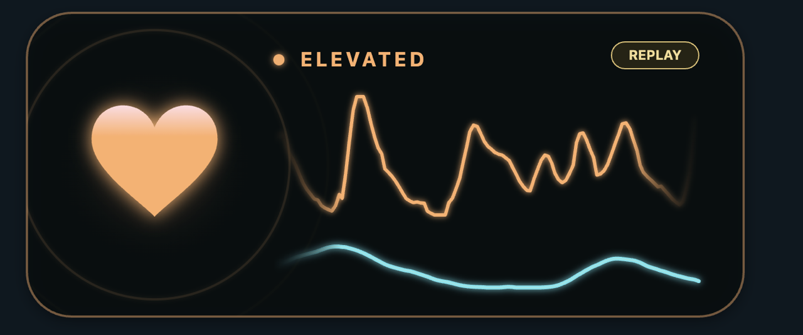

# Heart on Stream

Heart on Stream uses the Presage SmartSpectra SDK to turn webcam pulse and breathing estimates into a consent-first OBS overlay and mark rises above your own pulse baseline as recording chapters and local highlights.



Built for the [DEV Presage SmartSpectra SDK Challenge](https://dev.to/challenges/presage-2026-11-04).

Watch the [demo video (2:26)](heart-on-stream-demo.mp4). Clips marked LIVE are recordings of real camera sessions, sped-up clips show their speed, and the voice-over is synthetic.

## Quick start without a camera or key

Use Node.js 24 or later and Corepack. If Corepack is missing, install it with `npm install --global corepack`. Run these commands from the repository root. Corepack uses the pnpm version pinned in [package.json](package.json). [Corepack installation and usage](https://github.com/nodejs/corepack#how-to-install)

```sh
corepack enable pnpm
pnpm install --frozen-lockfile
pnpm replay -- samples/live-b-exertion-strong.jsonl
```

The first launch downloads Electron if its binary is missing. In the panel, click **Continue to setup**. Add the [OBS Browser Source](#obs-setup), then click **Start replay**. Look for the **REPLAY** badge and a highlight about 3 minutes 28 seconds into the recording.

| Reference recording                       | What it shows                                                           |
| ----------------------------------------- | ----------------------------------------------------------------------- |
| `live-a-framing-talking.jsonl`            | Camera framing hints and talking with the pulse-only configuration      |
| `live-b-calm.jsonl`                       | Calm sitting with pulse and breathing                                   |
| `live-b-calm-obs-shared-camera.jsonl`     | Calm sitting while OBS uses the same camera                             |
| `live-b-exertion-strong.jsonl`            | One highlight during still recovery after exertion                      |
| `live-b-exertion-recovery.jsonl`          | Framing hints, pauses, a second face, and one recovery highlight        |
| `live-b-exertion-talking.jsonl`           | Motion, seated recovery, and talking without a confirmed spike          |
| `live-b-virtual-camera-placeholder.jsonl` | The stopped OBS Virtual Camera placeholder and an unusable input signal |

See the [sample notes](samples/README.md) for the reference sessions and JSONL format.

## Live mode

1. Register with Presage and copy your SmartSpectra API key from the [Developer Admin Portal](https://physiology.presagetech.com/auth/register).
2. From the repository root, run `pnpm install --frozen-lockfile` if you skipped the quick start. Run `cp .env.example .env` and set `SMARTSPECTRA_API_KEY` in `.env`. Keep that file local and never commit it. [Environment template](.env.example)
3. Run `pnpm start`. Check **I am the only person on camera**, click **I agree**, then choose your camera and privacy mode. Click **Start session** to begin measurement. [Setup panel screenshot](docs/images/panel-setup.png)

Live mode needs a platform the SmartSpectra SDK supports: macOS on Apple silicon, Windows x64, or Linux x64/ARM64 with glibc 2.35 or newer. Replay works without the SDK's native runtime. The app quits when its window closes; to switch between replay and live mode, close it and launch again with the new command. Launching again while the app is open focuses the existing window and, if you requested different options, tells you to close the window and run the command again.

On macOS, camera permission belongs to the app that launched Electron, such as Terminal, iTerm, or VS Code. If access is denied, enable Camera for the launching app in **System Settings → Privacy & Security → Camera**, then quit and reopen that app before running `pnpm start` again.

## OBS setup

1. Add a **Browser** source with the URL `http://127.0.0.1:7777/overlay`. Set **Width** to **1920** and **Height** to **1080**, keep the default transparent custom CSS, and put the Browser Source above your camera source in the Sources list. [OBS Browser Source guide](https://obsproject.com/kb/browser-source)
2. For chapters, set **Settings → Output → Recording → Recording Format** to **Hybrid MP4**. Start recording in OBS before the moments you want to mark. OBS writes chapters when it finalizes the recording. It can add its own **Start** and trailing **Dummy** marker chapters. [OBS Hybrid MP4 guide](https://obsproject.com/kb/hybrid-mp4)
3. Open **Tools → WebSocket Server Settings**, enable the server on port **4455**, enable authentication, and set the same password as `OBS_WS_PASSWORD` in `.env` for live mode. `OBS_WS_URL` defaults to `ws://127.0.0.1:4455` and must be a `ws://` URL on `127.0.0.1`, `localhost`, or `[::1]`. [OBS WebSocket setup](https://github.com/obsproject/obs-websocket#using-obs-websocket)

Replay skips `.env`. With OBS authentication enabled, pass `OBS_WS_PASSWORD` in the launch environment to connect.

```sh
OBS_WS_PASSWORD=... pnpm replay -- samples/live-b-exertion-strong.jsonl
```

## How it works

### Privacy dial

| Mode            | Live capture           | What the overlay receives                                                                                                                                               |
| --------------- | ---------------------- | ----------------------------------------------------------------------------------------------------------------------------------------------------------------------- |
| Off             | Camera and SDK stopped | Mode and replay flag only                                                                                                                                               |
| Vibe (default)  | Camera and SDK running | Mode, replay flag, normalized beat and breath points (0–1 with session-relative times), intensity (calm, elevated, or spike), and status (calibrating, live, or paused) |
| Numbers         | Camera and SDK running | Vibe fields plus rounded pulse BPM (or “out of range”) and whole-number breathing rate when available                                                                   |
| Highlights only | Camera and SDK running | Mode and replay flag only. Local highlights and OBS chapters continue.                                                                                                  |

Vibe shows no BPM or breathing-rate numbers. The overlay receives normalized beat and breath waveform points with session-relative times, along with intensity and status. An attentive viewer could still estimate a rate from the rhythm. Use Highlights only when nothing should be visible. The app filters the payload before it reaches the overlay. Confidence, stability, baseline, and change from baseline stay out of every overlay payload. [Privacy projection](src/domain/privacy/project-overlay.ts) · [Numbers overlay screenshot](docs/images/overlay-numbers.png)

- **Cmd/Ctrl+Shift+M** cycles Vibe → Numbers → Highlights only during a session. Choose **Off** in the panel to end the session.
- **Cmd/Ctrl+Shift+P** pauses or resumes the session. Live pause stops capture and releases the app’s camera stream.

### From calibration to a highlight

1. **Calibrating** takes 12 seconds of measurement time. **Building your baseline** takes 25 seconds of eligible pulse input. In **Live**, the personal baseline is the median of eligible readings over a rolling 120-second window, excluding rises that could trigger a spike. An eligible pulse reading is stable, within 40–110 BPM, and has confidence of at least 50, with validation allowing measurement.
2. A spike is confirmed when the median pulse over the last 5 seconds stays at least **15 BPM above your own baseline** for **3 seconds**. The threshold rises to **20 BPM** if the SDK detected stable talking in the last **3 seconds**. Spikes have a **45-second cooldown**.
3. A second face pauses measurement immediately, clears readings from the panel, and excludes readings from that interval from session recordings. Other validation warnings immediately exclude pulse samples from the baseline and spike logic and withhold readings and waveform points from the overlay payload. The panel replaces its main pulse and breathing figures with dashes and clears and hides the pulse chart when it receives the updated session state for the warning. After more than 2 seconds of non-OK validation, measurement pauses. During these warnings and pauses, **Raw SDK values** can still show the latest SDK estimates, including older samples. Each main figure waits for a sample newer than the end of the warning or pause, and the chart returns with the pulse figure. Pulse eligibility for the baseline, spike logic, and overlay BPM resumes after a 12-second settling period once validation returns to OK. In live mode, 60 seconds of continuous non-OK validation triggers an automatic capture pause that releases the app’s camera stream until you choose **Resume**. If the camera disconnects, capture pauses with a message. Reconnect it and choose **Resume**. [Live panel screenshot](docs/images/panel-live.png)

### Highlights and chapters

Each confirmed spike saves a local highlight such as `spike +22 vs baseline` and requests a chapter if OBS is connected and recording.

After ending a session, use **Export YouTube chapters** on the receipt. The export starts with `00:00 Intro` and needs at least three chapters total. Times are rounded down to whole seconds. The app keeps the earliest highlights that are at least 10 seconds apart and leaves at least 10 seconds after the final chapter. An OBS-based export uses only highlights with offsets in the recording. A session-based export uses session times and duration.

Use **Save highlight list** to keep every highlight when there are too few chapters, the OBS timeline is unavailable, or the highlights span multiple recordings. The plain text list uses session times and includes OBS video times where available. [Receipt screenshot](docs/images/panel-receipt.png)

## SmartSpectra signals

| SDK signal                 | What Heart on Stream does with it                                                                                                                                                                                     |
| -------------------------- | --------------------------------------------------------------------------------------------------------------------------------------------------------------------------------------------------------------------- |
| Pulse rate                 | Shows the estimate and quality in the panel and shares rounded BPM in Numbers mode. Eligible readings drive the baseline and spike logic. The last usable rate fills gaps in the pulse waveform with synthetic beats. |
| Pulse waveform             | Normalizes samples to 0–1 to drive the overlay heart in Vibe and Numbers.                                                                                                                                             |
| Breathing rate             | Shows breaths per minute in the panel and shares stable readings in Numbers mode.                                                                                                                                     |
| Breathing waveform         | Normalizes chest waveform samples to 0–1 to animate the breathing ribbon in Vibe and Numbers.                                                                                                                         |
| Talking                    | Shows talking activity in the panel. A recent stable detection raises the spike threshold.                                                                                                                            |
| Validation status and hint | Shows the SDK condition and hint in the panel, gates readings, and controls validation pauses.                                                                                                                        |
| Processing status          | Shows the SDK lifecycle in the panel, including when it is starting, running, stopping, or in an error state.                                                                                                         |

The renderer SDK host passes the [metric configuration](src/infrastructure/smartspectra/sdk-host/metric-config.ts) as `requestedMetrics` and sets `enableTelemetry: false`. Config **(a)** requests pulse rate, pulse waveform, and talking. Config **(b)** adds chest breathing and breathing rate and is the default. Replay uses the signals already in the file.

Start with the [renderer composition](src/renderer/composition.ts) and [SDK host](src/infrastructure/smartspectra/sdk-host/sdk-host.ts) for camera selection, stream handoff, and SDK lifecycle. The [metrics mapper](src/infrastructure/smartspectra/metrics-mapper.ts) converts SDK output to timestamped signal frames. See the [Electron window host](src/infrastructure/electron/window-host.ts), [main composition](src/main/composition-root.ts), and [preload bridge](src/preload/preload.ts) for consent, SDK IPC binding, and frame delivery.

## Architecture

```text
Presentation (panel, overlay)      \
                                    > Application (use cases, ports) --> Domain
Infrastructure (SDK, OBS, storage) /
```

Dependencies point inward. Domain contains signal, session, privacy, and chapter logic. Application orchestrates sessions through ports. Presentation uses DTOs and the preload bridge. The main and renderer composition files are the entry points that wire infrastructure adapters. The [architecture test](test/architecture.test.ts) scans imports under `src/` and enforces these boundaries, including keeping Electron, the SDK, OBS, `ws`, and Node built-ins out of the core.

The Electron **renderer** owns camera capture and the SmartSpectra SDK instance. It forwards normalized signal frames over IPC. **Main** owns the session, overlay server, OBS connection, and local storage. Replay swaps the live IPC signal source for a JSONL source and runs through the same session logic.

## Consent and data handling

- **Camera.** The camera stays off until you click **I agree** and start a live session. The renderer gates camera access and Start, and Electron main grants video permission and starts measurement only for the trusted app page after consent. Heart on Stream never saves video or images or sends them off-device. Replay leaves the camera off.
- **Local storage.** Electron’s `userData/highlights.json` holds highlight timestamps and labels, change from your baseline, recent talking status, and OBS recording offsets when available. The panel remembers the camera’s ID and label in local storage. **Record session** or `pnpm start -- --record` opts in to numeric signal and status JSONL files in the project’s `recordings/` directory.
- **Deletion.** **Delete all data** is available on Setup and on the receipt. It stops the session, removes the highlights file and app-created session recordings, and clears the remembered camera choice after successful file deletion. Exported chapter and highlight text files are kept at the destinations you chose, and chapters already written into OBS recordings stay in those videos.
- **Network.** Pulse and breathing are computed on-device. The SDK contacts Presage to check the live API key associated with your developer account. SDK telemetry is disabled. During live measurement the Presage SDK also sends automatic LLM Insights check-ins: once readings stabilize and then every 60 seconds, it sends an allowlisted set of the vitals the SDK has computed (pulse rate, breathing rate and heart-rate variability, where available) with session and request identifiers, but no video or images, to Presage, which forwards them to a language model. Heart on Stream never requests or reads insights. Replay does not use the SDK. The overlay server binds only to `127.0.0.1`, checks the HTTP and WebSocket `Host` header, and checks `Origin` on WebSocket upgrades that supply it. OBS connections are loopback only. [Presage LLM Insights](https://smartspectra.presagetech.com/docs/llm-insights) · [Presage SDK telemetry and privacy](https://smartspectra.presagetech.com/docs/telemetry-and-privacy)
- **Intended use.** Heart on Stream is for wellness and entertainment. It is not a medical device.

## Testing and development

```sh
pnpm check
pnpm tune -- samples/*.jsonl
```

`pnpm check` runs TypeScript type checking, Biome, and Vitest, including the architecture test. With the default policy, the tuning report shows these session-relative times.

| Recording                        | Expected spikes  |
| -------------------------------- | ---------------- |
| `live-b-exertion-strong.jsonl`   | One at 207.878 s |
| `live-b-exertion-recovery.jsonl` | One at 745.814 s |
| All other reference recordings   | Zero             |

Replay uses the original measurement timestamps, so the same file and policy produce the same spike times. Re-run the quick-start command to inspect the strong-exertion sample in the panel and overlay.

## Known limitations

- In the reference runs, the camera-based pulse estimate rose one to three minutes after heavy exertion.
- Config (b) needs your upper chest in frame. A persistent `chestNotVisible` condition pauses measurement. Raise the laptop or sit back to bring more of your chest into view.
- At very high replay speeds, the overlay can skip ahead when it falls behind the recording.
- SmartSpectra SDK 3.5.0 offers no option to turn off automatic LLM Insights during live measurement. Heart on Stream discloses these check-ins before you click **I agree** or start a session.
- The Electron SDK takes its API key when it is constructed in the renderer, so the key reaches the app’s own sandboxed renderer after consent and Start. [SmartSpectra Electron integration](https://smartspectra.presagetech.com/docs/nodejs#electron-integration)
- macOS keeps its camera indicator on if OBS still uses the same camera. Check the panel’s **Camera off** status to confirm Heart on Stream released its stream.
- Measurement supports one face at a time. Guest mode is unavailable.
- Live testing was on macOS with Apple silicon.

## Credits and license

- [Presage SmartSpectra SDK](https://smartspectra.presagetech.com/docs/nodejs) provides webcam signal estimates under a proprietary license. Its [Electron example](https://github.com/Presage-Security/SmartSpectra/tree/main/nodejs/samples/electron-quickstart) served as a reference only. No sample code was copied.
- [obs-websocket-js](https://github.com/obs-websocket-community-projects/obs-websocket-js) connects to OBS, and [ws](https://github.com/websockets/ws) serves overlay updates.
- Heart on Stream is released under the [MIT license](LICENSE).
